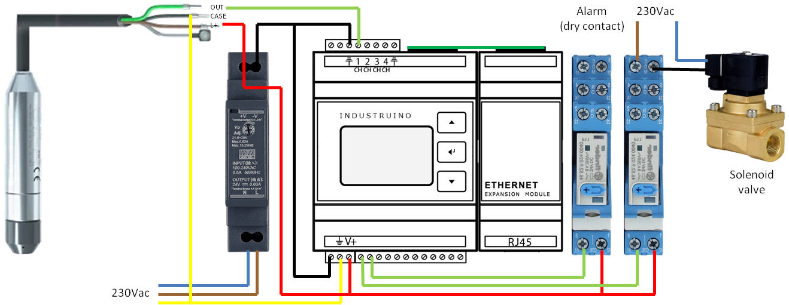

# Rain Tank Controller

[](https://industruino.com/)
[](https://www.arduino.cc/)
[](https://modbus.org/)
[](LICENSE)

An industrial-grade, standalone rainwater harvesting and cistern management system built on the [**Industruino D21G (IND.I/O)**](https://industruino.com/shop/product/industruino-ind-i-o-d21g-2) industrial Arduino platform. 

The controller monitors water level via a 4–20 mA hydrostatic submersible pressure probe, automates tank replenishment through an electric solenoid valve with hysteresis and safety cutoffs, provides a rich local user interface on an integrated 128×64 LCD screen, and integrates seamlessly into home automation systems (such as Home Assistant) over **Modbus TCP** when the [**Industruino Ethernet expansion module**](https://industruino.com/shop/product/ethernet-expansion-module-10) is connected.

---

## Key Features

- **Hydrostatic Level Sensing (4–20 mA)**:
  - High-precision 14-bit ADC sampling via the Industruino IND.I/O baseboard.
  - Wire-break (< 3.8 mA) and short-circuit / overcurrent (> 21.0 mA) fault detection with automatic fail-safe valve shutoff.
  - Digital first-order exponential moving average (EMA) low-pass filtering to dampen water surface ripples and wave turbulence.
- **Automated Level Regulation**:
  - Refill solenoid valve activates when the water level falls below the low threshold (`waterLevelLow_cm`).
  - Hysteresis band (`waterLevelHysteresis_cm`) prevents rapid cycling / valve chatter.
  - **Tank Geometry**: Volume calculations currently assume a **vertical cylinder** tank geometry ($\text{Volume (L)} = \text{height (cm)} \times \text{surface (cm}^2\text{)} / 1000$). Accurate height measurements apply to any tank, but volumetric estimations require a uniform vertical cross-section with the current implementation.
- **Fail-Safe & Protection Systems**:
  - **Valve Runtime Cutoff**: Automatically forces the valve closed and raises an alarm if filling runs continuously past `valveTimeout_min` (protects against pipe ruptures or sensor detachment).
  - **Anti-Seizure Valve Exercise**: Periodically activates the solenoid valve for a short duration (`valveRinseDuration_min`) if left idle for several weeks (`valveRinsePeriod_day`) to prevent mineral buildup and valve sticking.
  - **Hardware Watchdog**: Supervised by `WDTZero` with a 2-second hardware reset cycle.
  - **Alarm Relay**: Dedicated output channel for external beacons, sirens, or telemetry signaling.
- **Local User Interface (LCD & 3-Button Keypad)**:
  - 128×64 graphical display with a real-time horizontal level gauge (0–100%) and fill status.
  - Operational overview screen showing probe current (mA), water height (cm), estimated volume in Liters, valve/rinse state, and alarm codes.
  - Interactive menu system to view and adjust parameters (integer parameters with per-digit editing, boolean toggles, and IP octet editors).
  - 3-stage power-saving backlight control (Full $\rightarrow$ Dim $\rightarrow$ Off).
- **Ethernet & Modbus TCP (Port 502)**:
  - **Auto-Detected & Optional Hardware**: The controller operates fully autonomously without the Ethernet expansion module. The firmware probes the W5500 chip version during startup; if the module is not installed, network and Modbus services are bypassed automatically without startup delay or timeouts.
  - Automatically loads factory hardware MAC address from the onboard RTC EEPROM (I2C address `0x57`).
  - DHCP IP configuration with automatic RFC 3927 Link-Local (`169.254.x.x`) fallback, or static IP.
  - Full Modbus TCP Server (Unit ID 1) providing remote control, register-based configuration, and telemetry streaming.
- **Non-Volatile Storage**:
  - Configuration parameters persist in SAMD21 internal flash (`FlashStorage`) with magic-number validation and automatic factory-default fallback.

---

## System Architecture

```
                       +---------------------------------------+
                       |          Industruino D21G             |
                       |       (ATSAMD21G18 Cortex-M0+)        |
                       +---------------------------------------+
                                  |                 |
     +----------------------------+                 +----------------------------+
     |                                                                           |
[Analog In CH 1]                                                          [Digital Out CH 1 & 2]
     |                                                                           |
4-20mA Hydrostatic                                                        +------+------+
Pressure Transmitter                                                      |             |
(0 - 300 cm water)                                                   Solenoid Valve   Alarm Output
                                                                        (Refill)     (Beacon/Siren)

                               +--------------------+
                               |  Ethernet (W5500)  | <---> Modbus TCP (Home Assistant, ...)
                               +--------------------+
                               | 128x64 UC1701 LCD  | <---> Local Dashboard & Menu Navigation
                               +--------------------+
                               | 3-Button Membrane  | <---> Up / Down / Enter Keypad
                               +--------------------+
```

---

## Hardware Configuration & Pinout

### Wiring diagram



### List of equipment used
- Main controller : [Industruino D21G (IND.I/O)](https://industruino.com/shop/product/industruino-ind-i-o-d21g-2)
- Network interface (optional) : [Industruino Ethernet expansion module](https://industruino.com/shop/product/ethernet-expansion-module-10)
- Hydrostatic 4-20mA probe : [AF906](https://autosen.com/en/Process-Sensors/Level-sensors/Pressure-level-transmitter-AF906) from AutoSen (3m/0.3bar)  
  I'm using a ceramic probe with HDPE cable/EPDM seal (cheap probes usually have piezo sensor with PVC or PUR/O-ring and therefore significantly shorter service life)
- Power supply module (24V): [MeanWell HDR-15-24V](https://www.meanwell-web.com/en/mean-well-hdr-15-24-hdr-15-24)
- Relays (24V coil) : [Finder 46.52.9.024.0040](https://www.findernet.com/en/worldwide/series/46-series-miniature-industrial-relay-8-16a/type/type-4652-miniature-industrial-relay-8a/) + DIN rail adaptor  
(The one I had on hand—any relay with a 24V DC coil will work, IND.I/O digital outputs can drive up to 2A !)

### Industruino IND.I/O Board Connections

| Interface / Signal | Pin / Channel | Description |
| :--- | :--- | :--- |
| **Analog In 1** | `CH_LEVEL_PROBE` (`1`) | 4–20 mA current loop input from hydrostatic level transmitter |
| **Digital Out 1** | `CH_VALVE` (`1`) | 24V isolated high-side digital output controlling refill solenoid valve |
| **Digital Out 2** | `CH_ALARM` (`2`) | 24V isolated digital output driving alarm relay / signaling light |
| **Down Button** | Pin `23` (`D23`) | Membrane keypad Down navigation button |
| **Enter Button** | Pin `24` (`D24`) | Membrane keypad Enter / Confirm button |
| **Up Button** | Pin `25` (`D25`) | Membrane keypad Up navigation button |
| **LCD Backlight** | Pin `26` (`D26`) | PWM backlight brightness control (0–100%) |
| **LCD Controller** | SPI / UC1701 | 128×64 monochrome graphic LCD |
| **Ethernet Controller**| SPI / W5500 | 10/100 Mbps Ethernet communication |
| **EEPROM / RTC** | I2C (`0x57`) | MCP7940N RTC EEPROM storing hardware MAC address (`0xF0`–`0xF7`) |

---

## Modbus TCP Register Map

The controller runs a Modbus TCP server on standard **Port 502** with **Server ID `1`**.

### 1. Coils (Read / Write Bits — Function Codes 01, 05, 15)

| Address | Parameter | Access | Description |
| :---: | :--- | :---: | :--- |
| `0` | **Save Configuration** | R/W | Writing `1` writes working configuration to flash. Self-resets to `0`. |
| `1` | **Clear Alarms** | R/W | Writing `1` resets active alarms and turns off alarm relay. Self-resets to `0`. |
| `2` | **System Reboot** | R/W | Writing `1` stops watchdog petting, triggering a hardware reboot. |
| `3` | **DHCP Mode** | R/W | `1` = DHCP enabled, `0` = Static IP configuration. |

### 2. Discrete Inputs (Read-Only Bits — Function Code 02)

| Address | Signal | Access | Description |
| :---: | :--- | :---: | :--- |
| `0` | **Valve Relay Active** | R | `1` = Solenoid valve is currently energized (open). |
| `1` | **Alarm Relay Active** | R | `1` = Alarm output relay is energized. |
| `2` | **Rinsing Active** | R | `1` = Anti-seizure valve exercise cycle in progress. |
| `3` | **DHCP Active** | R | Mirror of current DHCP enabled state. |
| `4` | **Probe Alarm** | R | `1` = Level sensor out of range (< 3.8 mA or > 21.0 mA). |
| `5` | **Valve Timeout Alarm** | R | `1` = Valve remained open past safety timeout threshold. |

### 3. Holding Registers (Read / Write 16-Bit Words — Function Codes 03, 06, 16)

*Writing any holding register updates the controller's active RAM configuration immediately. Write Coil `0` to persist changes to flash.*

| Address | Parameter | Range / Units | Description |
| :---: | :--- | :---: | :--- |
| `0` | `probeMaxHeight_cm` | 0 – 999 cm | Sensor measuring range (height corresponding to 20 mA). Default: `300`. |
| `1` | `tankMaxHeight_cm` | 0 – 999 cm | Maximum physical tank overflow level height. Default: `125`. |
| `2` | `tankSurface_cm2` | 0 – 65,535 cm² | Tank horizontal cross-section area (used to calculate volume). Default: `33650`. |
| `3` | `waterLevelLow_cm` | 0 – 999 cm | Low-water refill threshold. Valve opens below this level. Default: `24`. |
| `4` | `waterLevelHysteresis_cm` | 1 – 99 cm | Refill shutoff hysteresis offset (`low + hysteresis`). Default: `6`. |
| `5` | `valveTimeout_min` | 1 – 59 min | Maximum continuous valve open timeout. Default: `30`. |
| `6` | `valveRinsePeriod_day` | 1 – 31 days | Maximum valve idle period before anti-seizure rinse. Default: `30`. |
| `7` | `valveRinseDuration_min` | 1 – 59 min | Duration of anti-seizure rinse cycle. Default: `1`. |
| `8` | `ipAddress` (MSB) | Octets 1 & 2 | High word of static IP address (e.g., `192.168`). |
| `9` | `ipAddress` (LSB) | Octets 3 & 4 | Low word of static IP address (e.g., `1.234`). |
| `10` | `ipSubnet` (MSB) | Octets 1 & 2 | High word of static subnet mask (e.g., `255.255`). |
| `11` | `ipSubnet` (LSB) | Octets 3 & 4 | Low word of static subnet mask (e.g., `255.0`). |
| `12` | `ipGateway` (MSB) | Octets 1 & 2 | High word of static gateway IP. |
| `13` | `ipGateway` (LSB) | Octets 3 & 4 | Low word of static gateway IP. |
| `14` | `ipDNS` (MSB) | Octets 1 & 2 | High word of static DNS server IP. |
| `15` | `ipDNS` (LSB) | Octets 3 & 4 | Low word of static DNS server IP. |

### 4. Input Registers (Read-Only 16-Bit Words — Function Code 04)

| Address | Parameter | Range / Units | Description |
| :---: | :--- | :---: | :--- |
| `0` – `15` | *Configuration Mirrors* | Same as above | Live mirror of configuration parameters. |
| `16` | **Probe Current** | microamperes ($\mu\text{A}$) | Measured 4–20 mA probe current (e.g., `4000` = 4.000 mA, `20000` = 20.000 mA). |
| `17` | **Water Level** | millimeters ($\text{mm}$) | Calculated water level based on filtered current (e.g., `1250` = 125.0 cm). |

---

## Project Structure

```
RainTankController/
├── RainTankController.ino    # Main firmware, setup(), loop(), and regulation state machine
├── include/
│   ├── config.h              # Pinout, timing constants, Configuration & MachineState structs
│   └── git_version.h         # Auto-generated Git commit SHA header (via prebuild hook)
├── src/
│   ├── Button.h / .cpp       # Debounced button driver (short press, long press, repeat)
│   ├── Sensor_4_20mA.h / .cpp# 4-20 mA current loop analog input handler & fault checking
│   ├── Relay.h / .cpp        # Relay output controller with I2C write caching & timeout
│   ├── LowPassFilter.h / .cpp# First-order IIR exponential moving average (EMA) filter
│   ├── Display.h / .cpp      # 128x64 UC1701 LCD driver, dirty-row cache, gauge bitmap renderer
│   ├── Menu.h / .cpp         # Interactive UI menu system & multi-digit / IP parameter editors
│   ├── Network.h / .cpp      # W5500 Ethernet driver, RTC MAC reader, DHCP / Link-Local
│   ├── ModbusService.h / .cpp# Modbus TCP server (Port 502) mapping coils, inputs, and registers
│   └── I2c.h / .cpp          # Wire I2C wrapper for register transactions with repeated START
├── .vscode/
│   ├── arduino.json          # Arduino board (`industruino:samd:industruino_d21g`) and prebuild hook
│   └── c_cpp_properties.json # IntelliSense configuration and include paths
├── get_git_version.py        # Python script to extract Git SHA into git_version.h
└── README.md                 # Project documentation
```

---

## Installation & Build Instructions

### Prerequisites

1. **Arduino IDE** (1.8.x or 2.x) or **VS Code** with the **Arduino extension**.
2. **Industruino Board Support Package**:
   - In Arduino IDE, open **Preferences** $\rightarrow$ **Additional Boards Manager URLs** and add:
     ```
     https://industruino.com/package_industruino_index.json
     ```
   - Open **Boards Manager**, search for `Industruino SAMD Boards`, and install version `1.0.1` (or latest).
   - Select Board: `Industruino D21G`.

3. **Required Arduino Libraries**:
   Install the following libraries:
   - `Indio` (Industruino IND.I/O baseboard driver)
   - `UC1701` (Industruino LCD controller driver)
   - `Ethernet2` (**Important**: Must be the **[Industruino Ethernet2 library](https://github.com/industruino/Ethernet2)**). The generic `Ethernet2` library configures an unsupported SPI clock divider on the SAMD21, whereas Industruino's version sets the SPI clock speed to the supported rate for reliable W5500 communication.
   - `ArduinoModbus` & `ArduinoRS485`
   - `FlashStorage` (Non-volatile emulation for SAMD21)
   - `WDTZero` (SAMD21 Watchdog timer)
   - `ArduinoLog`

4. **Python 3**:
   Required to run `get_git_version.py` which generates `include/git_version.h` during prebuild.

### Compiling and Uploading

#### Using VS Code:
1. Open the repository root in VS Code.
2. Ensure `.vscode/arduino.json` points to your correct serial COM port.
3. Press `Ctrl + Alt + U` (or run `Arduino: Upload`).

#### Using Arduino IDE:
1. Run `python get_git_version.py` once in the project root to generate `include/git_version.h`.
2. Open `RainTankController.ino`.
3. Select **Tools** $\rightarrow$ **Board** $\rightarrow$ **Industruino D21G**.
4. Select the corresponding Serial Port.
5. Click **Upload**.

---

## Home Assistant Integration

A complete, production-ready configuration containing all binary sensors, live telemetry sensors, configuration setpoints, derived volume/percentage sensors, and action buttons is provided in [`homeassistant_configuration.yaml`](homeassistant_configuration.yaml).

Add the contents of [`homeassistant_configuration.yaml`](homeassistant_configuration.yaml) to your Home Assistant `configuration.yaml` (or include it via packages) and set `host` to your controller's IP address, e.g.:

```yaml
modbus:
  - name: "raintank"
    type: tcp
    host: 192.168.1.234  # Replace with controller's IP
    port: 502

    sensors:
      - name: "Rain Tank Water Level"
        unit_of_measurement: "cm"
        slave: 1
        address: 17
        input_type: input
        scale: 0.1
        precision: 1
        device_class: distance
        state_class: measurement

      - name: "Rain Tank Sensor Current"
        unit_of_measurement: "mA"
        slave: 1
        address: 16
        input_type: input
        scale: 0.001
        precision: 2
        device_class: current
        state_class: measurement

    binary_sensors:
      - name: "Rain Tank Valve Relay State"
        unique_id: "raintank_valve_relay_state"
        slave: 1
        address: 0
        input_type: discrete_input
        device_class: opening

      - name: "Rain Tank Alarm Relay State"
        unique_id: "raintank_alarm_relay_state"
        slave: 1
        address: 1
        input_type: discrete_input
        device_class: opening

      - name: "Rain Tank Probe Fault"
        slave: 1
        address: 4
        input_type: discrete_input
        device_class: problem

      - name: "Rain Tank Valve Timeout Fault"
        slave: 1
        address: 5
        input_type: discrete_input
        device_class: problem
```

---

## License

This project is licensed under the MIT License — see the [LICENSE](LICENSE) file for details.
